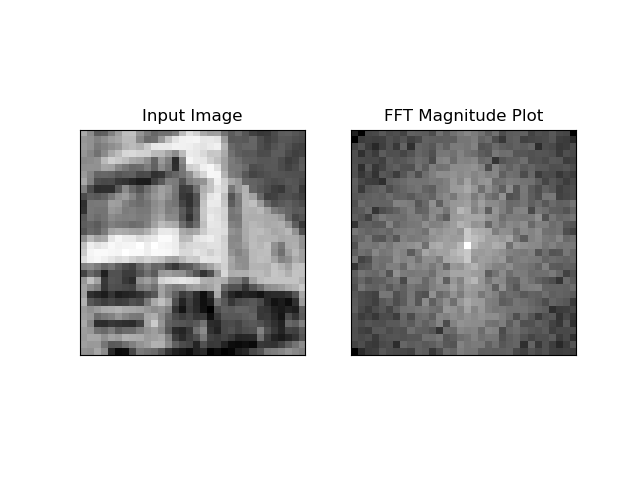
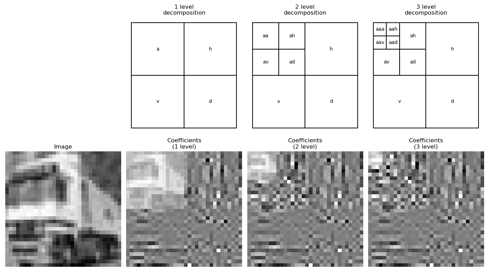
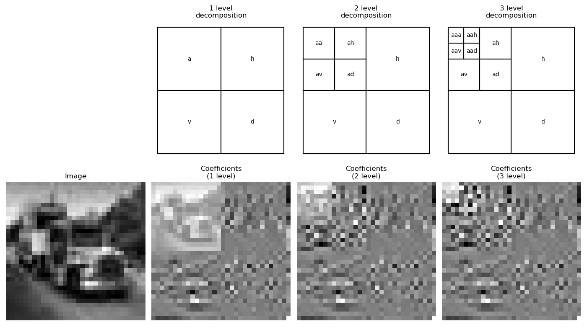
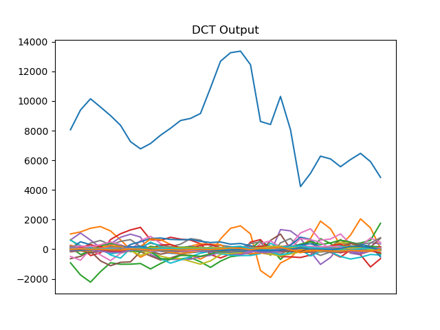

# EECS 351 Project: AI-Generated Image Detection
Ethan Kocheril, Jiayuan Zhu, Zhirui Wang, Ziyi Xie
## Overview
As the development of large language models continues to progress, the danger of generated images being
used for fraud, impersonation and other malicious ends will become more present.
Our project focuses on implementing ways to discover generated images through a combination of traditional
DSP techniques like the Discrete Cosine Transform and machine-learning models like the support vector machine
and logistic regression classifier. We are currently using images from the [CIFAKE dataset](https://www.kaggle.com/datasets/birdy654/cifake-real-and-ai-generated-synthetic-images), which is a dataset
comprised of 32x32 images, both real and ai-generated.

## Methods
At the moment, we have just computed the FFT, DWT, and DCT of real and generated images. 
We applied code from opencv, pywavelets, and scipy to get the FFT, DWT, and DCT, respectively.

## Progress So Far
So far, we have come to a decision regarding the machine learning technologies that we'd like to begin using, specifically the support vector machine and logistic regression classifier. We have also begin to compute the DCT, DWT and FFTs of the images in the CIFAKE dataset. A big challenge that we have run into is finding a good dataset. We were initially going to use the GenImage dataset, but we struggle to extract any images from the multi-part zip archive. In its place, we have decided to use CIFAKE for the time being. We would like to consult the course staff regarding the suitability of this dataset for our project. At the moment, the differences between the generated and real images are unclear. We would like to spend more time researching traditional DSP techniques for identifying generated images for inspiration on how to better apply the FFT, DWT, and DCT. 

## Plan for the future
- Consult with course staff about the suitability of CIFAKE for our project's purpose.
- Look into how to better apply the FFT, DWT, and DCT
- Apply the above transforms to the CIFAKE dataset and record observations so that we may better understand any patterns that might emerge and how they can be used to classify images.
## New tools
DCT
