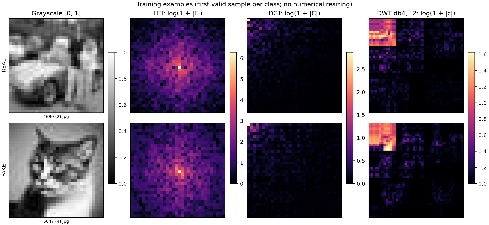
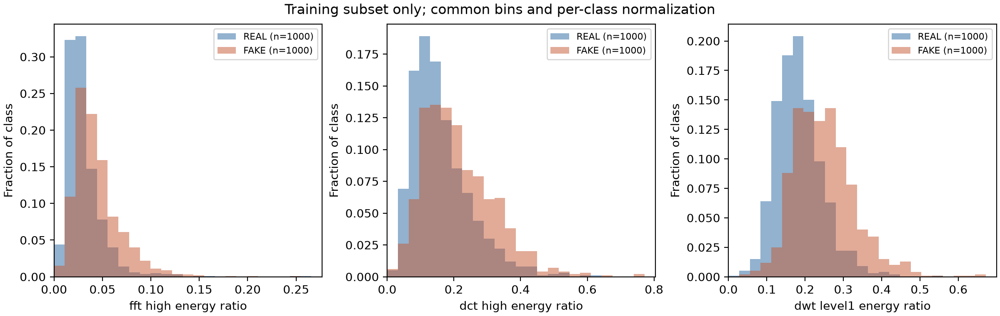
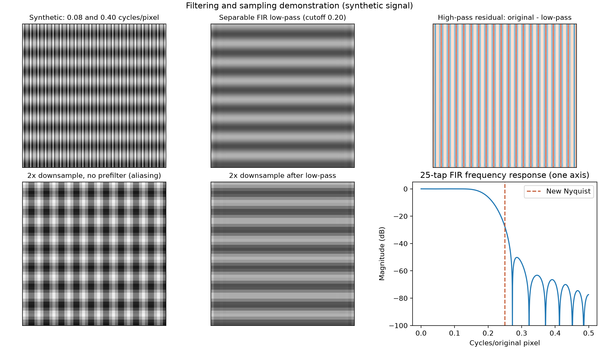

# EECS 351 Project: AI-Generated Image Detection
Ethan Kocheril, Jiayuan Zhu, Zhirui Wang, Ziyi Xie
## Overview
As the development of large language models continues to progress, the danger of generated images being
used for fraud, impersonation and other malicious ends will become more present.
Our project focuses on implementing ways to discover generated images through a combination of traditional
DSP techniques like the Discrete Cosine Transform and machine-learning models like the support vector machine
and logistic regression classifier. We are currently using images from the [CIFAKE dataset](https://www.kaggle.com/datasets/birdy654/cifake-real-and-ai-generated-synthetic-images), which is a dataset
comprised of 32x32 images, both real and ai-generated.

## Methods
At the moment, we have just computed the FFT, DWT, and DCT of real and generated images.
We applied code from opencv, pywavelets, and scipy to get the FFT, DWT, and DCT, respectively.


## Progress So Far
So far, we have come to a decision regarding the machine learning technologies that we'd like to begin using, specifically the support vector machine and logistic regression classifier. We have also begin to compute the DCT, DWT and FFTs of the images in the CIFAKE dataset. A big challenge that we have run into is finding a good dataset. We were initially going to use the GenImage dataset, but we struggle to extract any images from the multi-part zip archive. In its place, we have decided to use CIFAKE for the time being. We would like to consult the course staff regarding the suitability of this dataset for our project. At the moment, the differences between the generated and real images are unclear. We would like to spend more time researching traditional DSP techniques for identifying generated images for inspiration on how to better apply the FFT, DWT, and DCT.

## Plan for the future
- Consult with course staff about the suitability of CIFAKE for our project's purpose.
- Look into how to better apply the FFT, DWT, and DCT
- Apply the above transforms to the CIFAKE dataset and record observations so that we may better understand any patterns that might emerge and how they can be used to classify images.
## New tools
DCT

## Task 1 Experiment: DSP Feature Extraction

The sections above describe our initial prototype and plans. We have now extended
that work into a reproducible batch experiment using CIFAKE's original train/test
partitions. This update covers DSP analysis and feature export; classifiers remain
future work.

### Experiment setup

With random seed **42**, we processed **1,000 REAL + 1,000 FAKE training images**
and **200 REAL + 200 FAKE test images**, with no skipped images. Each image kept
its native **32x32** resolution and was converted to grayscale in `[0, 1]`.
Labels are explicitly **REAL = 0** and **FAKE = 1**.

For each image, we extracted 11 numerical features:

- **FFT:** low-, mid-, and high-frequency energy ratios, excluding DC. Radial
  boundaries are 0.15 and 0.35 cycles/pixel.
- **DCT:** low/high AC energy ratios (boundary 0.15 cycles/pixel) and AC energy
  concentration, using the orthonormal type-II DCT.
- **DWT:** horizontal, vertical, and diagonal detail-energy ratios, plus two
  scale-specific ratios, using a true 2D `db4` decomposition at level 2 with
  symmetric boundary extension.

Feature definitions and implementation details are in the
[Task 1 technical guide](docs/task1.md#features).

### Transform comparison

The figure below shows one selected training image from each class and its FFT,
DCT, and DWT representations. Color limits are shared between REAL and FAKE within
each transform column. `log(1 + |coefficient|)` compresses the display range so
weaker coefficients remain visible; energy features use squared original
coefficients, not the logarithmic display values.



### Training-set results

We compared feature distributions using only the training subset. The table shows
**mean +/- sample standard deviation**, with 1,000 images per class. Energy ratios
are fractions from 0 to 1.

| Feature | REAL | FAKE |
| --- | --- | --- |
| FFT high-frequency energy ratio | 0.0306 +/- 0.0209 | 0.0444 +/- 0.0246 |
| DCT high-frequency energy ratio | 0.1617 +/- 0.0876 | 0.2136 +/- 0.1061 |
| DWT fine-scale (level 1) detail-energy ratio | 0.1845 +/- 0.0610 | 0.2500 +/- 0.0808 |



In this subset, FAKE images have higher average high-frequency and fine-scale
energy ratios. The distributions overlap substantially, so these observations do
not establish a reliable decision threshold or classification accuracy. The
[complete training summary](docs/results/train_summary.csv) contains all 11
features; the [experiment metadata](docs/results/metadata.json) records sample
counts, feature settings, seed, and library versions. Test features were exported
for future evaluation and were not used for these comparisons.

### Filtering and sampling experiment

We also used a **synthetic** image containing gratings at 0.08 and 0.40
cycles/pixel to demonstrate low-pass filtering, the high-pass residual, and
2x downsampling. A separable 25-tap FIR low-pass with cutoff 0.20 cycles/pixel
attenuates frequencies above the new Nyquist limit of 0.25 cycles/original pixel.
Downsampling without prefiltering produces visible aliasing; prefiltering reduces
it. This illustrates convolution, filter frequency response, and sampling, and
is separate from the CIFAKE feature pipeline.



### Reproduce the experiment

Use Python 3.10+ and manually extract CIFAKE into `datasets/CIFAKE/`, containing
`train/REAL`, `train/FAKE`, `test/REAL`, and `test/FAKE`. Run these commands from
the repository root in Windows PowerShell:

```powershell
py -3 -m venv .venv
.venv/Scripts/python.exe -m pip install -r requirements.txt

# Small demo: 5 images per class in train, 2 per class in test
.venv/Scripts/python.exe demo.py

# Reproduce the 2,000-train / 400-test experiment above
.venv/Scripts/python.exe -m src.task1 --train-per-class 1000 --test-per-class 200 --seed 42

# Mathematical and data-integrity checks
.venv/Scripts/python.exe -m unittest discover -s tests -v
```

Use `--data-dir` to choose another extracted dataset location. On macOS/Linux,
create the environment with `python3 -m venv .venv` and use `.venv/bin/python`.
The demo writes to `outputs/demo/`; the standard experiment writes to `outputs/`:

- `features/train_features.csv` and `features/test_features.csv`: one row per
  image, with its relative path, split, label, and the same 11 feature columns.
- `features/train_summary.csv`: training-only class means and standard deviations.
- `figures/`: the three figures above.
- `metadata.json`: reproducibility settings and processing counts.

All **16 tests passed**, covering transform properties, constant images,
deterministic balanced sampling, corrupt-image handling, split separation, and
CSV output. The full 120,000-image run is supported with `--all`, but has not been
executed for the results reported here. The figure and summary copies under
`docs/` preserve this experiment for GitHub; new runs write to `outputs/`.

### Limitations and next steps

CIFAKE's low resolution, compression, preprocessing, and wavelet boundary effects
can influence these features. Its FAKE class comes from Stable Diffusion 1.4;
these results do not establish generalization to other generators. We will next
use the exported features for Logistic Regression and evaluate on the held-out
test partition. No classifier has been trained in Task 1.

References: [CIFAKE original paper](https://arxiv.org/abs/2303.14126) and
[CIFAR-10 source and original report](https://www.cs.toronto.edu/~kriz/cifar.html).
