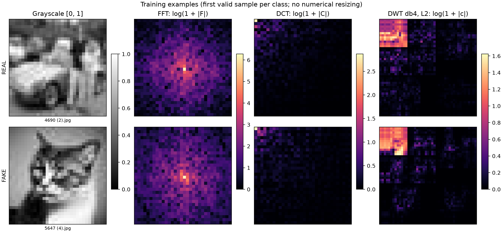
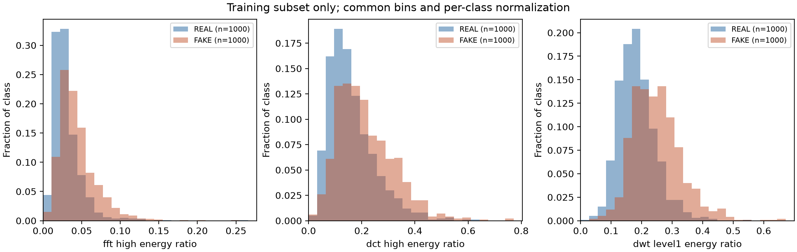
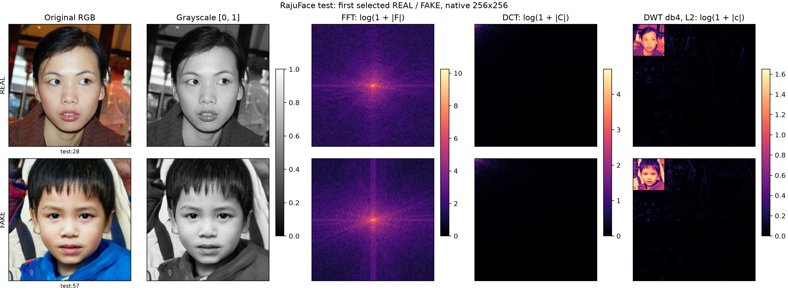
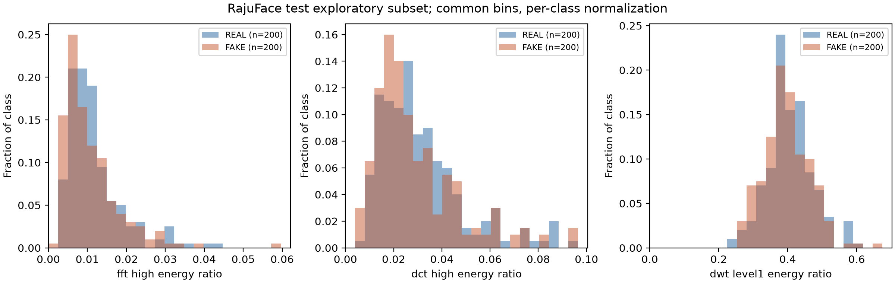

# AI-Generated Image Detection Using DSP and Machine Learning

**University of Michigan | EECS 351 | Fall 2026**

Ethan Kocheril, Jiayuan Zhu, Zhirui Wang, Ziyi Xie

[Project website](https://eecs351-team.github.io/EECS351-project/) |
[Team repository](https://github.com/eecs351-team/EECS351-project)

[Overview](#project-overview) | [Datasets](#datasets) | [Methods](#methodology) |
[Results](#results-and-discussion) | [Usage](#usage) | [Limitations](#limitations-and-future-work) |
[Team](#team-contributions) | [Publishing](#github-pages-and-documentation)

## Project Overview

Real photographs and generated images may look convincing while differing in
frequency and scale statistics. Our research question is: **can compact,
interpretable DSP features help distinguish real and AI-generated images across
datasets and generators?** We examine Fourier, cosine, and wavelet representations
before testing their usefulness with machine learning.

**Completed:** reproducible DSP extraction, balanced sampling, CSV exports, and
REAL/FAKE comparisons on CIFAKE and RajuFace. **Planned:** Logistic Regression,
possible SVM comparison, and classifier generalization tests. No trained model or
classification performance is available yet.

## Datasets

| Property | CIFAKE | RajuFace / 140k Real and Fake Faces |
| --- | --- | --- |
| Source | [Kaggle dataset](https://www.kaggle.com/datasets/birdy654/cifake-real-and-ai-generated-synthetic-images) | [Hugging Face dataset](https://huggingface.co/datasets/RajuFace/140k-Real-and-Fake-Faces) |
| Images | 120,000: 60,000 REAL + 60,000 FAKE | 140,000: 70,000 REAL + 70,000 FAKE |
| Native resolution | 32x32 | 256x256 |
| REAL source | CIFAR-10 photographs; diverse object categories | FFHQ face photographs |
| FAKE source | Stable Diffusion 1.4 (diffusion) | StyleGAN (GAN) |
| Original splits | Train 100,000; test 20,000 | Train 100,000; validation 20,000; test 20,000 |
| Split proportions | Train/test = 5:1 | Train/validation/test = 5:1:1 (71.43% / 14.29% / 14.29%) |

Both pipelines use **REAL = 0, FAKE = 1** and preserve original partitions.
CIFAKE established the small-image baseline; RajuFace checks the same features on
higher-resolution faces and a different generator family. Differences in content,
resolution, sources, and generation methods prevent a controlled comparison of
diffusion and GAN artifacts.

## Methodology

```text
Images -> Grayscale [0,1] -> FFT / DCT / DWT -> 11 numerical features
                                               v
                                  Class statistics and figures
                                               v
                              Classifier and evaluation (planned)
```

Pillow converts RGB to 8-bit `L` grayscale, followed by float64 conversion and
division by 255. Images retain their native dimensions, with identical preprocessing
for REAL and FAKE. There is no resizing, sharpening, or denoising.

| Transform | Purpose and features |
| --- | --- |
| **2D FFT** | Express spatial variation as complex sinusoids. Extract low/mid/high radial energy shares, excluding DC, at boundaries 0.15 and 0.35 cycles/pixel. |
| **2D DCT** | Express the image in an orthonormal type-II cosine basis. Extract low/high AC energy shares at 0.15 cycles/pixel and AC energy concentration. |
| **2D DWT** | Separate detail by orientation and scale. Use `db4`, level 2, symmetric extension; extract horizontal/vertical/diagonal shares and two scale shares of total detail energy. |

The shared extractor returns the same 11 finite, label-independent feature columns
for both datasets. RajuFace's `generator` field is metadata only. Energy features
use squared coefficients; `log(1 + |coefficient|)` is for visualization only.
See the [feature definitions](docs/task1.md#features) and
[RajuFace technical guide](docs/rajuface.md) for normalization and sampling details.

### Connection to EECS 351

| Course concept | Implemented work |
| --- | --- |
| Basis representations and frequency analysis | FFT/DCT/DWT image analysis and energy features. |
| Linear filtering | A separate synthetic demonstration uses a separable 25-tap FIR low-pass filter and high-pass residual. |
| Sampling and aliasing | The same synthetic signal is downsampled by 2 with and without prefiltering. |
| Out-of-class technique | Logistic Regression is planned; it has not been trained or evaluated. |

The [filtering and sampling figure](docs/figures/filtering_sampling.png) is explicitly
synthetic and does not modify dataset images. We do not automatically count the
three transforms as three distinct in-class requirements; confirm coverage with
the instructor.

## Results and Discussion

Both experiments used seed **42**, balanced class counts, and **no skipped images**.
Tables show **mean +/- sample standard deviation**. Ratios are fractions.

### Experiment 1: CIFAKE

Processed **1,000 REAL + 1,000 FAKE training images** and exported features for
**200 REAL + 200 FAKE test images**. These comparisons use training data only.



*First valid selected training image per class; color limits are shared within
each transform column. These images illustrate the representations.*

| Feature | REAL (n=1,000) | FAKE (n=1,000) |
| --- | --- | --- |
| FFT high-frequency energy ratio | 0.03065 +/- 0.02089 | 0.04441 +/- 0.02464 |
| DCT high-frequency energy ratio | 0.16170 +/- 0.08762 | 0.21359 +/- 0.10611 |
| DWT level-1 detail-energy ratio | 0.18446 +/- 0.06100 | 0.24996 +/- 0.08083 |



*Common bins and per-class normalization. FAKE means are higher for these three
features in this training subset, with substantial overlap.*

[All 11 feature summaries](docs/results/train_summary.csv) |
[Counts and configuration](docs/results/metadata.json)

### Experiment 2: RajuFace

A **10 REAL + 10 FAKE test-split demo** passed before the initial
**200 REAL + 200 FAKE test-split analysis**. Images remained 256x256. The demo and
initial samples overlap and are not independent experiments.



*First valid image per class after seeded buffer sampling: test indices 28 (REAL)
and 57 (FAKE). They were not selected to maximize visible differences.*

| Feature | REAL (n=200) | FAKE (n=200) |
| --- | --- | --- |
| FFT high-frequency energy ratio | 0.01181 +/- 0.00707 | 0.01085 +/- 0.00739 |
| DCT high-frequency energy ratio | 0.03140 +/- 0.01750 | 0.02915 +/- 0.01780 |
| DWT level-1 detail-energy ratio | 0.40652 +/- 0.06589 | 0.39717 +/- 0.06579 |



*REAL means are slightly higher for these features in this subset. Distributions
overlap substantially. These are exploratory test-subset statistics; no model or
thresholds were tuned on these data.*

[All 11 feature summaries](docs/results/rajuface_test_summary.csv) |
[Schema, commit, counts, and configuration](docs/results/rajuface_metadata.json)

### Interpretation

Individual transform plots can look similar because they show aggregate frequency
structure on a logarithmic scale. Subtle numerical differences may still help a
classifier, but visual similarity alone neither proves nor rules out useful
classification. The direction of these mean differences changes between datasets;
this does not isolate a generator effect. **No accuracy, precision, recall, F1,
or confusion matrix is available.** Held-out classification is needed to evaluate
feature usefulness.

## Installation

Use **Python 3.10+**. Direct dependencies are NumPy, SciPy, PyWavelets, Matplotlib,
Pillow, and Hugging Face `datasets`; versions are in `requirements.txt`.
Run from the repository root in Windows PowerShell:

```powershell
py -3 -m venv .venv
.venv/Scripts/python.exe -m pip install -r requirements.txt
```

On macOS/Linux, use `python3 -m venv .venv` and `.venv/bin/python` below.
Manually extract CIFAKE into `datasets/CIFAKE/{train,test}/{REAL,FAKE}/`.
RajuFace requires network access and streams through Hugging Face; the full dataset
is not downloaded automatically.

## Usage

Each command performs feature extraction, descriptive analysis, and figure export.
Choose fresh output directories to preserve prior runs.

```powershell
# CIFAKE demo: 5/class train, 2/class test
.venv/Scripts/python.exe demo.py --output-dir outputs/cifake-demo-new

# CIFAKE experiment: 1,000/class train, 200/class test
.venv/Scripts/python.exe -m src.task1 --train-per-class 1000 --test-per-class 200 --seed 42 --output-dir outputs/cifake-run-new

# RajuFace: run the 10/class demo first; continue only after it passes
$env:HF_HOME = Join-Path (Get-Location) '.cache/huggingface'
$rajuRevision = '1f99c8e831601e3a300dd3de670df23384a9be6c'
.venv/Scripts/python.exe -m src.rajuface --per-class 10 --seed 42 --revision $rajuRevision --output-dir outputs/rajuface/demo-new
.venv/Scripts/python.exe -m src.rajuface --per-class 200 --seed 42 --revision $rajuRevision --output-dir outputs/rajuface/initial-new

# Offline mathematical, sampling, and export checks
.venv/Scripts/python.exe -m unittest discover -s tests -v
```

Use `--data-dir` for another CIFAKE location. RajuFace supports `--dataset-id`,
`--split`, `--revision`, `--buffer-size`, and `--max-scan`; it rejects existing
output directories. Defaults are a 128-row encoded shuffle buffer and a maximum
scan of 10,000 source rows. Sampling has prefix/order bias and is not uniform over
the full split. Balance failures or unrecoverable network errors stop the run
without publishing partial results. See the [CIFAKE](docs/task1.md) and
[RajuFace](docs/rajuface.md) guides for details.

Runs save feature CSVs, class summaries, figures, and reproducibility metadata.
Datasets and `outputs/` are Git-ignored; selected publication copies are in `docs/`.
**28 tests passed** in the existing validation, alongside both live RajuFace runs
and a CIFAKE smoke run. There is no classification command yet.

## Project Structure

```text
demo.py                  Small CIFAKE run
requirements.txt         Runtime dependencies
src/
  dataset.py             CIFAKE loading and shared grayscale preprocessing
  rajuface_dataset.py    Schema validation and balanced HF streaming
  dsp_features.py        Shared FFT, DCT, DWT and 11-feature extractor
  analysis.py            Summaries and saved figures
  task1.py               CIFAKE CLI
  rajuface.py            RajuFace CLI
tests/                   CIFAKE and RajuFace validation
docs/
  task1.md               CIFAKE technical guide
  rajuface.md            RajuFace technical guide
  figures/               Selected experiment figures for publication
  results/               Compact summaries and experiment metadata
  *.pdf                  Original course requirements and project proposal
datasets/                Local data (ignored)
outputs/                 Generated runs (ignored)
```

## Limitations and Future Work

- CIFAKE's 32x32 resolution and wavelet boundary effects limit fine-detail analysis.
- Handcrafted features may capture compression, content, or generator-specific
  artifacts. Normalized frequency bands do not remove resolution dependence.
- RajuFace sampling can reflect source ordering; larger and more diverse samples
  are needed. The optional 1,000-per-class experiment has not been run.
- Overlapping distributions do not establish detection accuracy. We plan Logistic
  Regression with training-only scaling and held-out evaluation, followed by an
  SVM comparison if time permits.
- Future studies include radial power profiles, unseen generators, cross-dataset
  evaluation, and sensitivity to compression/resizing. CIFAKE model compatibility
  must be verified; downsampling to 32x32 removes detail and belongs in a separate
  experiment from native-resolution analysis.

## Team Contributions

Team names are recorded in existing documentation. Individual contributions have
not been documented and must be completed by the team.

| Team member | Contribution |
| --- | --- |
| Ethan Kocheril | To be completed by the team. |
| Jiayuan Zhu | To be completed by the team. |
| Zhirui Wang | To be completed by the team. |
| Ziyi Xie | To be completed by the team. |

## GitHub Pages and Documentation

The [project website](https://eecs351-team.github.io/EECS351-project/) is built by
GitHub Pages from the root of `main` with the
[Just the Docs](https://just-the-docs.com/) Jekyll theme. No build workflow is needed:
pushing to `main` rebuilds the site, and **Settings > Pages** shows the deployment
status. This README is the repository overview and is not a website page.

```text
_config.yml              Site settings, theme version, navigation links, footer
index.md                 Home page and grader cheat sheet
pages/                   One Markdown file per website page
  methods/, results/     Section pages; index.md is the section landing page
docs/task1.md, rajuface.md   Technical guides (listed under Reproducibility)
docs/figures/            Figures shown on the site
_includes/               figure.html (numbered figures) and MathJax setup
_sass/custom/custom.scss Small style additions
```

To edit a page, change its Markdown file. To add a page, create a `.md` file in `pages/`
with front matter such as:

```yaml
---
title: New page
nav_order: 5          # position in the sidebar
parent: Results       # optional: nest under a section
---
```

Link between pages with relative `.md` paths (for example `[Datasets](datasets.md)`);
GitHub Pages converts them to site URLs. Add figures with
``
and math with `$$ ... $$`. Code, data, and this README are excluded from the site in
`_config.yml`.

To preview locally (optional; requires Ruby), create a `Gemfile` containing
`source "https://rubygems.org"` and `gem "github-pages", group: :jekyll_plugins`, then run
`bundle install` and `bundle exec jekyll serve` and open
`http://localhost:4000/EECS351-project/`. Otherwise, push and check the live site.

## References

- J. J. Bird and A. Lotfi, *CIFAKE: Image Classification and Explainable
  Identification of AI-Generated Synthetic Images*, 2023.
  [Paper](https://arxiv.org/abs/2303.14126); dataset linked above.
- A. Krizhevsky, *Learning Multiple Layers of Features from Tiny Images*, 2009.
  [CIFAR-10 source and report](https://www.cs.toronto.edu/~kriz/cifar.html).
- RajuFace, *140k Real and Fake Faces*.
  [Dataset card, label definitions, and source attribution](https://huggingface.co/datasets/RajuFace/140k-Real-and-Fake-Faces).
