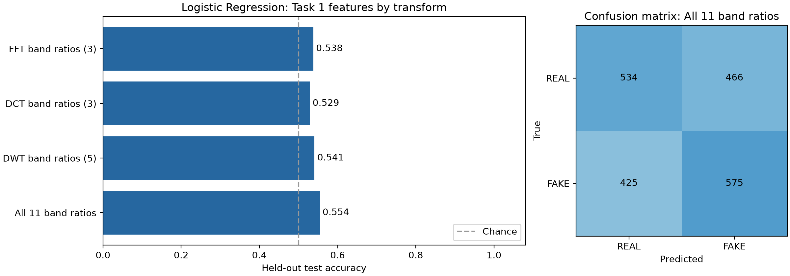
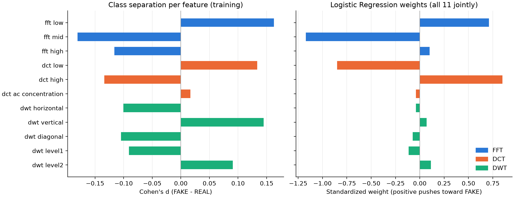
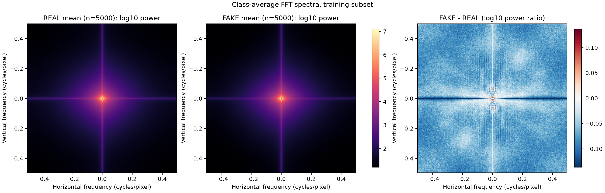
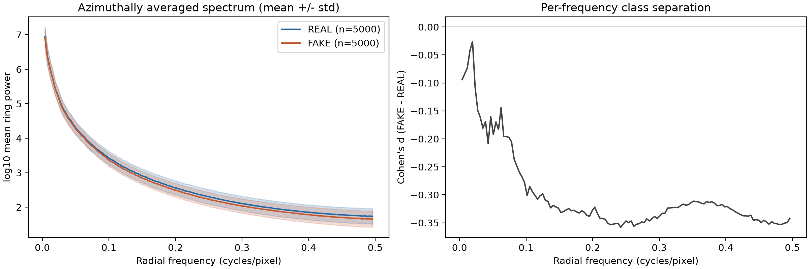
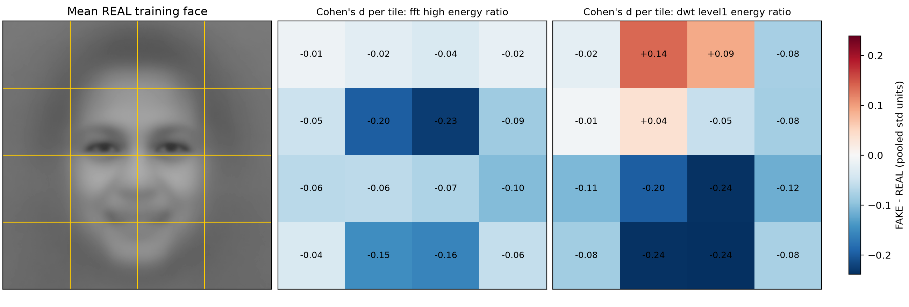
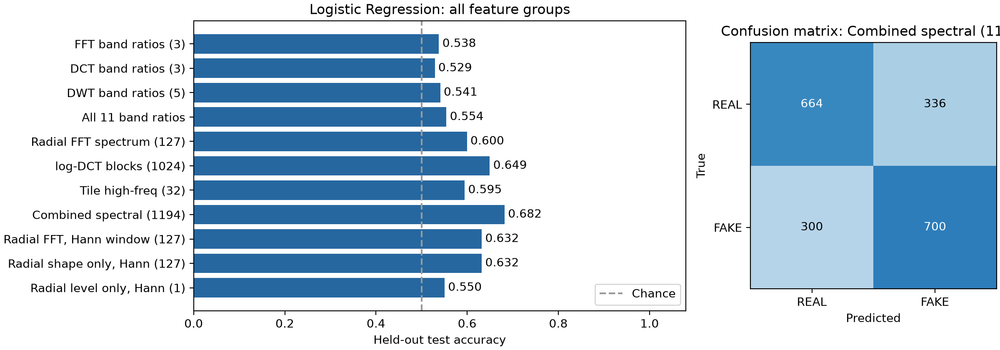
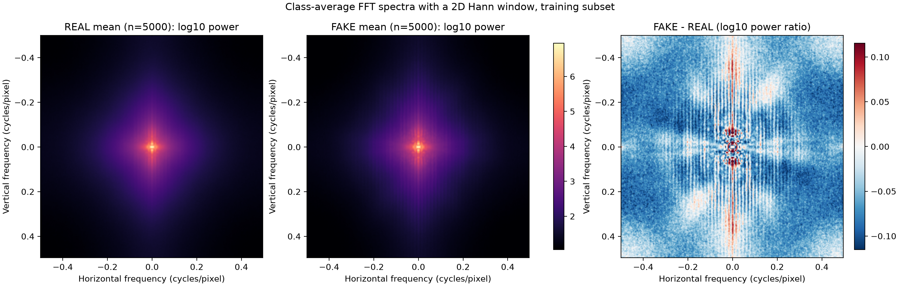

# Task 2: Logistic Regression on 140k Real and Fake Faces

Ethan Kocheril, Jiayuan Zhu, Zhirui Wang, Ziyi Xie

CIFAKE's 32x32 images showed only small class differences in Task 1. Task 2 asks
whether a higher-resolution dataset, finer spectral features, and Logistic
Regression can separate real photographs from images made by a generative
adversarial network (GAN).

Abbreviations: FFT = Fast Fourier Transform, DFT = discrete Fourier transform,
DCT = Discrete Cosine Transform, DWT = Discrete Wavelet Transform, DC = the
zero-frequency term (average brightness), AC = all other frequencies, CV =
cross-validation, F1 = the balance of precision and recall, ROC AUC = area under the
receiver operating characteristic curve (0.5 = chance, 1 = perfect).

## Data

[140k Real and Fake Faces](https://huggingface.co/datasets/RajuFace/140k-Real-and-Fake-Faces)
contains 70,000 FFHQ (Flickr-Faces-HQ) photographs (REAL, label 0) and 70,000 StyleGAN faces
(FAKE, label 1), all aligned and stored as 256x256 JPEGs in parquet shards.
Download these two shards (287 MB each) into `datasets/140k/`:

```text
datasets/140k/
  validation-00000-of-00002.parquet   # 10,000 images, 5,000 per class -> training
  test-00000-of-00002.parquet         # 10,000 images, 5,000 per class -> held-out test
```

Both classes use the same JPEG luminance quantization table and chroma
subsampling (recorded in `metadata.json`), so final-stage compression is not a
label shortcut. Earlier processing still differs: StyleGAN produced 1024x1024
images and the dataset authors resized both classes to 256x256.

## Run

```powershell
.venv/Scripts/python.exe -m pip install -r requirements.txt

# Reported experiment: 5,000 per class train, 1,000 per class test (several minutes on CPU)
.venv/Scripts/python.exe -m src.task2 --train-per-class 5000 --test-per-class 1000 --seed 42

# Compression control: re-encode every image at JPEG quality 90 first
.venv/Scripts/python.exe -m src.task2 --recompress-quality 90 --output-dir outputs/faces_q90

.venv/Scripts/python.exe -m unittest discover -s tests -v
```

Outputs go to `outputs/faces/` by default: `metrics.csv`, `metadata.json`,
`features/{train,test}_features.npz`, and nine figures.

## Features

Feature groups come in two stages. The **basic** stage follows the project
proposal: the 11 Task 1 band ratios, compared by transform. The **extended** stage
adds finer spectral features that keep the spectrum's shape.

| Stage | Group | Size | Definition |
| --- | --- | --- | --- |
| Basic | FFT band ratios | 3 | Low/mid/high radial energy shares (boundaries 0.15, 0.35 cycles/pixel). |
| Basic | DCT band ratios | 3 | Low/high AC energy shares at 0.15 cycles/pixel, and AC energy concentration. |
| Basic | DWT band ratios | 5 | Horizontal/vertical/diagonal detail shares and level-1/level-2 shares (`db4`, level 2). |
| Basic | All 11 band ratios | 11 | Task 1 `extract_features`, unchanged, on the full 256x256 image. |

| Group | Size | Definition |
| --- | --- | --- |
| Radial FFT spectrum | 127 | log10 mean power in 1-cycle-per-image rings, DC and corners excluded ([Durall et al.](https://arxiv.org/abs/2003.01826)). |
| log-DCT blocks | 1024 | log10 of orthonormal DCT-II magnitudes averaged in 8x8 coefficient blocks ([Frank et al.](https://arxiv.org/abs/2003.08685)). |
| Tile high-frequency | 32 | FFT high-band ratio and DWT level-1 share on each tile of a 4x4 grid. Faces are aligned, so tiles cover similar content in every image. |
| Combined | 1194 | All 11 band ratios plus the three extended groups. |
| Radial, Hann window (diagnostic) | 127 | Radial FFT spectrum after a 2D Hann window. |
| Radial shape / level (diagnostic) | 127 / 1 | Windowed log radial spectrum minus its own mean over rings / that mean alone. |
| JPEG table (control) | 1 | Luminance quantization-table sum only. |

Each group is standardized and classified with L2 Logistic Regression. The
regularization strength is selected by 5-fold cross-validation on the training
shard only; the test shard is used once.

## Results

5,000 training and 1,000 test images per class, seed 42 (`docs/results/faces_metrics.csv`):

| Stage | Feature group | Features | CV accuracy | Test accuracy | Test F1 | Test ROC AUC |
| --- | --- | --- | --- | --- | --- | --- |
| Basic | FFT band ratios | 3 | 0.545 | 0.538 | 0.582 | 0.554 |
| Basic | DCT band ratios | 3 | 0.533 | 0.529 | 0.578 | 0.543 |
| Basic | DWT band ratios | 5 | 0.532 | 0.541 | 0.529 | 0.553 |
| Basic | All 11 band ratios | 11 | 0.576 | 0.555 | 0.563 | 0.583 |
| Extended | Radial FFT spectrum | 127 | 0.613 | 0.600 | 0.600 | 0.628 |
| Extended | log-DCT blocks | 1024 | 0.673 | 0.650 | 0.653 | 0.718 |
| Extended | Tile high-frequency | 32 | 0.608 | 0.595 | 0.614 | 0.630 |
| Extended | Combined | 1194 | 0.694 | **0.682** | 0.688 | 0.752 |
| Diagnostic | Radial FFT, Hann window | 127 | 0.650 | 0.632 | 0.627 | 0.680 |
| Diagnostic | Radial shape only (Hann) | 127 | 0.648 | 0.632 | 0.628 | 0.679 |
| Diagnostic | Radial level only (Hann) | 1 | 0.555 | 0.551 | 0.565 | 0.566 |
| Control | JPEG table only | 1 | 0.500 | 0.500 | 0.000 | 0.500 |

### Basic stage: the proposal's feature-group comparison



No single transform stands out: FFT, DCT, and DWT band ratios each reach 53-54%,
and all 11 together reach 55.5%. The 11-feature model is only slightly biased
toward FAKE (575 of 1,000 FAKE and 534 of 1,000 REAL correct).



Every band ratio has |d| < 0.2. All three transforms point the same way: FAKE
faces put a slightly larger share of their energy in low frequencies and coarse
wavelet scales. Read the weights with care. Several ratios sum to one within a
transform (FFT low+mid+high, DCT low+high, DWT H+V+D, DWT level 1+2), so a weight
acts as a contrast between bands. For example, the DCT low and high weights are
equal and opposite, and together they mean "more high-frequency share pushes
toward FAKE, given the other features", even though the one-feature d for DCT
high is negative. Joint weights and single-feature effects need not agree.

### Extended stage

With 2,500 training images per class, the same groups reached 0.554, 0.582,
0.649, 0.597, and 0.670. Doubling the training data changed accuracy by about one
point, so more images from the same distribution are unlikely to help much.



The class-average spectra show **no periodic peaks or grid pattern**, the usual
signature of GAN upsampling. FAKE images have slightly less power above about
0.1 cycles/pixel (Cohen's d about -0.3), which is the opposite of the CIFAKE
trend.





FAKE faces have less fine-scale energy in the central tiles: the eye row for the
FFT high band and the mouth/chin rows for the DWT level-1 share (|d| up to about
0.24). The top corners, mostly background, differ least. All per-tile effects are
small, which matches the modest classification accuracy.



### Diagnostics: windowing, and spectral shape vs. level

The DFT treats each image as one period of a periodic signal. Where the left and
right (or top and bottom) edges do not match, the periodic extension has a step,
and a step leaks power along the frequency axes. That leakage is the bright "+"
through the center of the unwindowed spectra above, and it depends on whatever
happens to be at the image border, not on how the face was made. Multiplying the
mean-removed image by a 2D Hann window (`np.hanning` along each axis, scaled to
unit mean power) tapers the edges to zero before the FFT.



- The dark horizontal line in the unwindowed difference map disappears, so it
  was edge leakage, not a generator effect.
- With the window, the radial spectrum classifies better: 0.600 to **0.632**
  test accuracy, and AUC 0.628 to 0.680. Removing a nuisance component that
  varies from image to image helps the classifier.
- The windowed difference map shows a red band along the vertical frequency axis
  (|fy| about 0.3-0.45): FAKE faces have relatively more power in fine horizontal
  structure. A fine ripple pattern near the axes is also visible; we have not
  identified its cause.

Is the useful information the spectrum's overall **level** (how much fine detail
there is) or its **shape** (how power is spread across frequency)? We split each
windowed log radial spectrum into its mean over rings (level, one number) and
the remainder (shape, the spectrum with that mean subtracted). Shape alone keeps
the full accuracy (0.632). Level alone reaches only 0.551. **The useful
information is in the spectral shape, not in the overall amount of
high-frequency energy.** This also explains why the normalized Task 1 band
ratios are weak. Normalizing does not remove the useful information; three wide
bands are simply too coarse to describe the shape.

## Interpretation and limitations

- Finer spectral features beat the Task 1 band ratios (0.682 vs 0.555). The
  shape/level split shows that the spectrum's shape carries the signal.
- Windowing before the FFT is a cheap, standard step that raised radial-spectrum
  accuracy by about 3 points.
- Accuracy is still far from the near-perfect results that spectral detectors
  report on native-resolution GAN faces. A likely cause is the 4x anti-aliased
  downsampling to 256x256 by the dataset authors, which removes most frequencies
  where upsampling artifacts live. StyleGAN's own binomial-filtered upsampling
  makes these artifacts weaker to begin with. We cannot test this directly
  without native-resolution images.
  <!-- TODO: confirm the exact figures and resolution in Durall et al. 2020 and
       Frank et al. 2020 before quoting numbers. -->
- Training and test images come from different shards of one dataset, so these
  results do not show generalization to other generators.
- Other classifiers on the same features are compared in [Task 3](task3.md);
  a radial basis function (RBF) Support Vector Machine (SVM) reaches 0.742 on
  the combined set.
- Next step: robustness to re-compression (`--recompress-quality`) and further
  downsampling.
