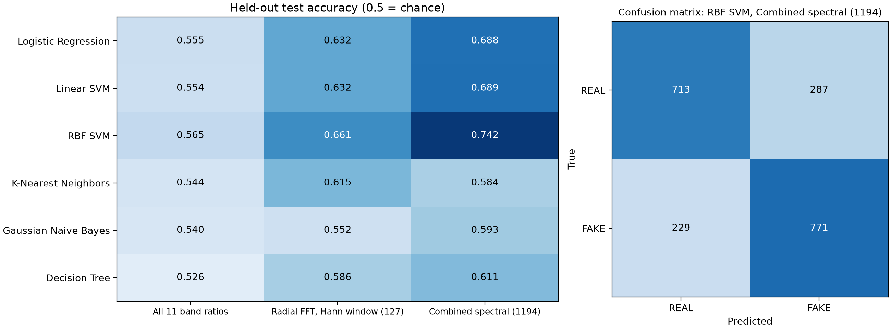

# Task 3: Other Classification Methods

Ethan Kocheril, Jiayuan Zhu, Zhirui Wang, Ziyi Xie

Task 2 used Logistic Regression only. Task 3 asks whether a more complex
classifier improves detection when it sees the **same DSP features**. As planned in
the project proposal, we compare Logistic Regression with linear and RBF Support
Vector Machines, K-Nearest Neighbors, Gaussian Naive Bayes, and a Decision Tree.

## Setup

- **Data.** The Task 2 features of 140k Real and Fake Faces: 5,000 REAL + 5,000
  FAKE training images from the validation shard, and 1,000 + 1,000 held-out test
  images from a different test shard. Task 3 reads the saved feature files and
  does not decode any image again.
- **Feature sets.** The proposal's 11 band ratios (FFT, DCT, DWT), the Hann-windowed
  radial FFT spectrum (127 values), and the combined spectral set (1,194 values).
  See [Task 2](task2.md#features) for definitions.
- **Preprocessing.** Every feature is standardized. The 1,194-value set is then
  reduced to 100 principal components, so every classifier sees the same inputs.
  KNN and RBF SVM are slow and lose accuracy in very high dimensions. The scaler
  and PCA are fitted inside each training fold.
- **Model selection.** Hyperparameters are chosen by stratified 5-fold
  cross-validation on the training shard only (accuracy). The test shard is used
  once, after selection.

| Classifier | Hyperparameters searched |
| --- | --- |
| Logistic Regression (L2) | C in 1e-4 ... 1e3 (8 values) |
| Linear SVM | C in 1e-4 ... 1 (5 values) |
| RBF SVM | C in {0.1, 1, 10, 100}; gamma in {0.01, 0.1, 1, 10} / (number of inputs) |
| K-Nearest Neighbors | k in {5, 15, 45, 135} |
| Gaussian Naive Bayes | none |
| Decision Tree | max depth in {3, 5, 8, 12, none}; min samples per leaf in {1, 20, 50, 100, 200} |

## Run

```bash
# Task 2 must have run first; it saves features/{train,test}_features.npz
.venv/bin/python -m src.task3 --features-dir outputs/faces_hann/features --output-dir outputs/task3
```

About 7 minutes on an 8-core laptop, most of it the RBF SVM search.

## Results

Held-out test accuracy (`docs/results/task3_metrics.csv`; the file also has CV
accuracy, precision, recall, F1, the confusion counts, and the chosen
hyperparameters):

| Classifier | 11 band ratios | Radial FFT, Hann (127) | Combined (1194 -> 100 PCA) |
| --- | --- | --- | --- |
| Logistic Regression | 0.555 | 0.632 | 0.688 |
| Linear SVM | 0.554 | 0.632 | 0.689 |
| RBF SVM | **0.565** | **0.661** | **0.742** |
| K-Nearest Neighbors | 0.544 | 0.615 | 0.584 |
| Gaussian Naive Bayes | 0.540 | 0.552 | 0.593 |
| Decision Tree | 0.526 | 0.586 | 0.611 |

The best model, RBF SVM on the combined set, reaches **0.742 test accuracy and
0.810 ROC AUC** (713 of 1,000 REAL and 771 of 1,000 FAKE correct).



## Discussion

- **The features matter more than the classifier.** With Logistic Regression
  fixed, richer features raise accuracy from 0.555 to 0.688 (+13 points). With
  the combined features fixed, the best classifier adds 5 points over Logistic
  Regression. No classifier gets far above chance on the 11 band ratios. A
  classifier cannot recover information that the features do not carry.
- **The RBF SVM is the only consistent improvement.** It is the best on every
  feature set, and its advantage over Logistic Regression grows with the
  features (+1, +3, +5 points). The class boundary is somewhat nonlinear, and
  the extra benefit appears only when the features are rich enough to show it.
- **Logistic Regression and the linear SVM are almost identical.** Both learn a
  linear boundary; only the loss function differs.
- **KNN, Naive Bayes, and the Decision Tree are worse than the linear models.**
  - **Naive Bayes** assumes the features are independent given the class.
    Neighboring spectral values are strongly correlated, so it counts the same
    evidence many times.
  - **KNN** gets worse when moving from 127 to 1,194 features (0.615 to 0.584).
    Distances in 100 PCA dimensions are dominated by directions of large
    variance, such as face content, that carry little class information.
  - **The Decision Tree** splits on one feature at a time. A signal spread
    weakly over many correlated features suits it poorly.
- **Cost.** The RBF SVM search took about 2.5 minutes for each of the two larger
  feature sets, compared with about 10 seconds for Logistic Regression. Logistic
  Regression also stays interpretable: its weights map back to frequencies.
- **PCA did not hurt.** Logistic Regression on 100 principal components (0.688)
  matches Logistic Regression on all 1,194 features in Task 2 (0.682).

## Limitations

- **Two choices sit at the edge of their search ranges:** C = 100 for the RBF
  SVM on the 11 band ratios, and 200 samples per leaf for the Decision Tree on
  the 11 band ratios and the radial spectrum. All three results are within 9
  points of chance, and widening the ranges once changed them by about one point
  or less, so the conclusions above do not depend on them.
- **The test set has 2,000 images**, so accuracies carry about +/- 2 points of
  sampling uncertainty (95% interval). Differences of a point or two, such as
  Logistic Regression against the linear SVM, are not meaningful.
- **One dataset and one generator.** These results do not show how the
  classifiers generalize to other generators or to further compression or
  resizing.
